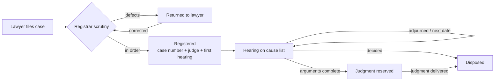
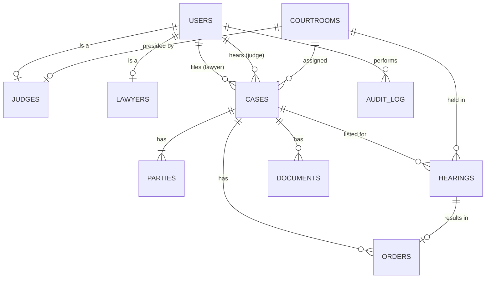

# ⚖ Courtroom Management System

A desktop application built with **Java 21, JavaFX and MySQL (JDBC)** that runs the everyday work of a district court: lawyers file cases online, the Registrar checks and registers them, hearings are scheduled without clashes, judges record orders from the cause list, and every case keeps its full history until judgment.

Mini-project for **UCS553 – Enterprise Web Application**.

---

## Contents

- [Who uses it](#who-uses-it)
- [How a case moves through the system](#how-a-case-moves-through-the-system)
- [Features](#features)
- [Syllabus coverage](#syllabus-coverage)
- [Tech stack](#tech-stack)
- [Project structure](#project-structure)
- [Database design](#database-design)
- [How to run](#how-to-run)
- [Sample logins and data](#sample-logins-and-data)
- [Tests](#tests)

---

## Who uses it

| Role | What they do |
|---|---|
| **Registrar** | Runs the court office: manages judges, lawyers and courtrooms, checks new filings, registers cases, schedules hearings, publishes the cause list, views reports and backs up decided cases |
| **Judge** | Hears the cases on the cause list, records orders and next dates, reserves and delivers judgments |
| **Lawyer** | Files cases with parties and documents, corrects returned filings, follows hearing dates and reads orders |
| **Public** | Anyone can check the status of a case by its number from the login screen, without an account |

## How a case moves through the system



## Features

**Login**
- Full-window court design with live figures, court-in-session status and the next hearings on today's cause list
- Role tabs (Registrar, Judge, Lawyer), salted SHA-256 passwords, "remember me" stored with object serialization
- Public case-status look-up without signing in

**Registrar**
- Dashboard: pending cases, today's hearings, scrutiny queue, courtroom use, cases by type
- **Judges / Lawyers**: live search, filters, add/edit with validation, reset password, activate/deactivate, CSV import of lawyers
- **Courtrooms**: add, edit, close/reopen, presiding judge, today's load
- **Scrutiny**: review a filing with its parties and documents, then register it (automatic case number such as `CS/101/2026`, judge, first hearing in a free slot) or return it with the defects
- **Hearings**: diary with filters; list, move or cancel hearings. Every booking is checked so that no judge, courtroom or lawyer is double-booked, and Sundays, holidays and full courtrooms are refused
- **Cause list**: any day and courtroom, exported as a printable text file or CSV
- **Reports**: bar and pie charts, judge workload, audit log, CSV export, backup of decided cases to a `.ser` archive and a viewer to open it again

**Judge**
- Dashboard: today's hearings, the coming week, judgments to write
- **Cause list** for any day with **Record order**: order text (with ready-made templates), outcome, and the next date picked from free slots
- **My cases**, **Reserved judgments** (deliver judgment) and a three-week **Calendar**

**Lawyer**
- Dashboard: active cases, hearings this week, returned filings with the reasons
- **File a new case**: type, details, urgent flag, any number of petitioners and respondents, documents by drag and drop
- **Returned filings**: correct and refile using the same form
- **My cases**, **Hearings** (30-day diary) and a searchable **Orders** feed

**Everywhere**: a case file window with overview, parties, hearings, orders and documents; background loading so the window never freezes; toast notifications; activity logged to `logs/court.log`.

## Syllabus coverage

| Unit | Topic | Where it is used |
|---|---|---|
| **1** | Packages, project structure | `com.court.model`, `dao`, `dao.impl`, `service`, `controller`, `ui`, `util`, `exception`, `dto` |
| | Classes and objects, encapsulation | `CourtCase` (status only changes through `moveTo()`), `Courtroom`, `Party` |
| | **Abstract class, inheritance** | `User` → `Registrar`, `Judge`, `Lawyer`; `DashboardController` → three dashboards; `JdbcSupport` → all DAOs |
| | **Polymorphism** | `user.getDashboardFxml()` opens a different screen per role |
| | **Interfaces** | `GenericDao<T, ID>`, `UserDao`, `CaseDao`, `HearingDao` … and their `impl` classes; functional interfaces `SqlWork`, `RowMapper`, `SaveAction` |
| | static vs instance | `SessionManager`, `AppConfig`, `SceneManager` (static); services and DAOs (instance) |
| | Access modifiers | private fields, protected members in `User`, `DashboardController`, `JdbcSupport` |
| | Build tool | Maven (`pom.xml`) with JavaFX, Ikonli, MySQL driver and JUnit |
| **2** | Exception hierarchy, custom exceptions | `ValidationException` ← `ScheduleConflictException`, `InvalidStatusTransitionException`; `AuthenticationException` (checked); `DataAccessException` (unchecked, wraps `SQLException`) |
| | ArrayList / LinkedHashMap / TreeMap / EnumMap | DAO results; cause list grouped by room; hearings per day; counts per status |
| | **HashSet** | `ScheduleRules` – clash detection with keys like `J2@10:30` |
| | **HashMap** | judge per courtroom, case counts per type |
| | **Iterator** | `UserService.importLawyers()` removes blank and header lines while looping |
| | **Comparator** | `CauseListService.BY_ROOM_THEN_TIME`, `DashboardDaoImpl` hearing order, sorting users by name |
| | **Generics** | `GenericDao<T, ID>`, `TableFilter<T>`, `BackgroundTask.run(Callable<T> …)`, `UiFactory.textColumn(TableColumn<T,String> …)` |
| | Objects, Optional, Math | `Objects.requireNonNull/equals/hash`; `Optional` from `findById/findByUsername`; `Math.round` for rates and averages |
| | LocalDate / LocalTime | hearing dates and slots, `ChronoUnit.DAYS.between`, `CourtClock`, holidays |
| **3** | **Byte streams** | `DocumentService.copyBytes()` – uploaded PDFs/images copied with `FileInputStream`/`FileOutputStream` |
| | **Character streams** | `CauseListService` and `ReportService` write with `BufferedWriter`; CSV import reads with `BufferedReader` |
| | **Serialization** | `BackupService` archives decided cases (`ObjectOutputStream`) and reads them back; `RememberMeStore` |
| | Logging | `java.util.logging` configured by `logging.properties` → `logs/court.log` |
| | Properties files | `db.properties`, `app.properties`, optional `db.local.properties` read by `AppConfig` |
| **4** | JDBC architecture | `DBConnection` → `DriverManager` → MySQL Connector/J |
| | INSERT / UPDATE / DELETE / SELECT | all DAO classes, always with `PreparedStatement` and `ResultSet` |
| | **Transactions** | `DBConnection.inTransaction()`: registering a case (case + first hearing), recording an order (order + hearing + case + next hearing), filing (case + parties + documents), saving a judge (users + judges) |
| | **DAO pattern** | interfaces in `dao`, JDBC code in `dao.impl`; controllers never contain SQL |
| **5** | Application lifecycle | `Main.init()` (config, database check), `start()`, `stop()` |
| | Stage, Scene, Scene Graph | `SceneManager` switches scenes in one stage; `CourthouseGraphic` draws with shapes |
| | Layouts | BorderPane (dashboards), HBox/VBox everywhere, GridPane (forms, `FormDialog`), StackPane (login layers, badges), FlowPane (calendar) |
| | Controls | Label, TextField, PasswordField, TextArea, CheckBox, ComboBox, DatePicker, ToggleButton, Button, ProgressBar, TabPane |
| | Tables and lists | TableView on every list screen, ListView for orders and activity, custom cell factories |
| | Events and listeners | button handlers, live search, selection listeners, drag and drop, double-click to open |
| | Validation and feedback | red fields and messages, dialogs that stay open on errors, confirmations, toasts |

## Tech stack

| Part | Technology |
|---|---|
| Language | Java 21 |
| User interface | JavaFX 21 (OpenJFX), FXML, CSS |
| Icons | Ikonli (Feather and Material Design packs) |
| Database | MySQL 8 |
| Database access | JDBC with MySQL Connector/J, DAO pattern |
| Build | Maven |
| Logging | java.util.logging |
| Tests | JUnit 5 |

## Project structure

```
src/main/java/com/court/
 ├── Main.java, Launcher.java   application start
 ├── model/        User, Registrar, Judge, Lawyer, CourtCase, Party, Hearing, CourtOrder, CaseDocument, enums
 ├── dto/          records that carry screen data (HearingRow, CaseSummary, DashboardStats ...)
 ├── dao/          DAO interfaces (GenericDao<T, ID> ...)
 │   └── impl/     JDBC implementations on top of JdbcSupport
 ├── service/      business rules: CaseService, HearingService, ScheduleRules, UserService, BackupService ...
 ├── controller/   JavaFX controllers, one per screen
 ├── ui/           reusable UI: FormDialog, TableFilter, SlotPicker, CaseDetailsDialog, CourthouseGraphic ...
 ├── exception/    custom exceptions
 └── util/         DBConnection, AppConfig, PasswordUtil, Validators, SceneManager, UiFactory ...
src/main/resources/
 ├── view/         FXML screens
 ├── css/style.css theme
 └── *.properties  database, app and logging settings
src/test/java/     JUnit tests
database/
 ├── schema.sql, seed.sql
 ├── sample-documents/sample-petition.pdf
 └── sample-lawyers-import.csv
```

## Database design



Tables: `users`, `judges`, `lawyers`, `courtrooms`, `cases`, `parties`, `hearings`, `orders`, `documents`, `holidays`, `notifications`, `audit_log` (see `database/schema.sql`).

## How to run

**Requirements:** JDK 21 or newer, MySQL 8, Maven (IntelliJ IDEA includes Maven).

1. **Create the database** (from the project folder):
   ```bash
   mysql -u root -p < database/schema.sql
   mysql -u root -p courtroom_db < database/seed.sql
   ```
   On a Mac with the MySQL installer, use `/usr/local/mysql/bin/mysql` instead of `mysql`.
2. **Database password**: `db.properties` uses user `root`, password `root`. If yours is different, create `db.local.properties` in the project folder (it is ignored by Git):
   ```properties
   db.password=your_password
   ```
3. **Run**:
   ```bash
   mvn clean javafx:run
   ```
   In IntelliJ: Maven panel → Plugins → javafx → **javafx:run**.

The sample data uses dates relative to the day you load it, so re-run both SQL scripts whenever you want fresh "today" hearings.

## Sample logins and data

| Role | Username | Password |
|---|---|---|
| Registrar | `registrar` | `admin123` |
| Judge | `judge1` … `judge4` (one per courtroom) | `judge123` |
| Lawyer | `lawyer1` … `lawyer8` | `lawyer123` |

- 44 cases at every stage, about 100 hearings with orders, hearings listed for today in all four courtrooms
- Try the public look-up with case number `CS/101/2026`
- Try **Lawyers → Import from CSV** with `database/sample-lawyers-import.csv` (the last line is deliberately invalid, to show the error report)
- Sample documents open `database/sample-documents/sample-petition.pdf`

Files the app creates while running (all ignored by Git): `logs/court.log`, `documents/` (uploads), `reports/` (exports), `backups/` (archives).

## Tests

```bash
mvn test
```

30 JUnit tests cover clash detection and scheduling rules, case status transitions, case numbering, input validation, password hashing, the court clock, byte-stream copying, CSV quoting and the serialization round trip of the case archive.
